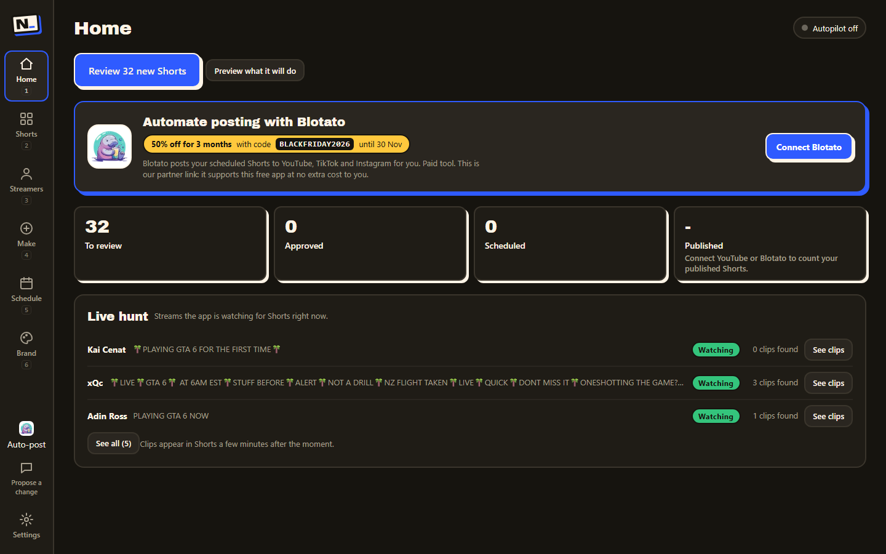
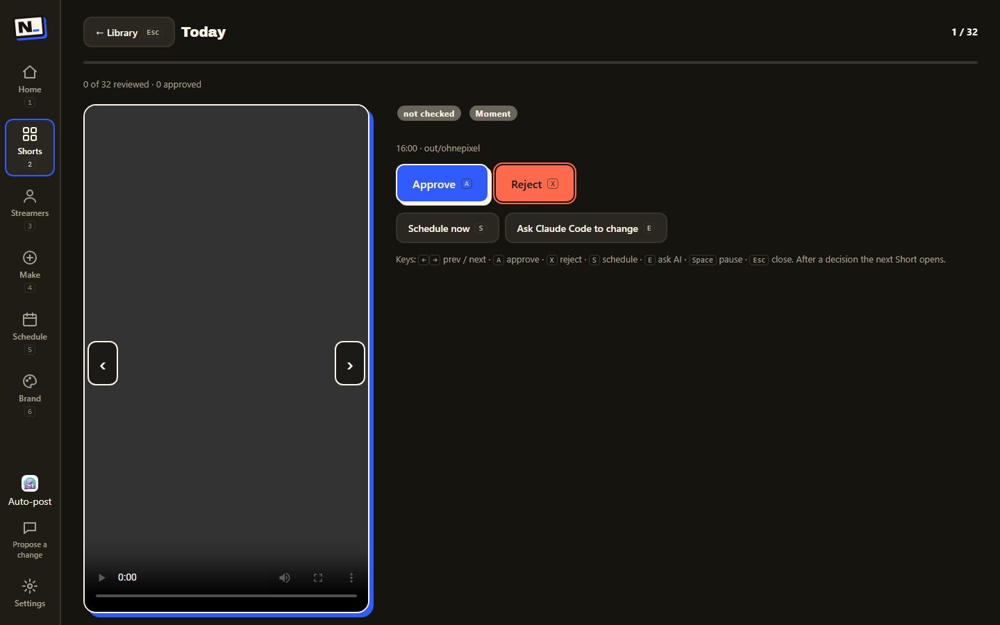

<h1 align="center">gta6-clipper</h1>

<p align="center">
<b>Type one sentence. Get finished 9:16 GTA 6 Shorts from live streams and videos.</b><br>
It finds the loud, chat-heavy moments, frames the streamer and the game, adds word-by-word captions and a hook, and waits for your OK. Nothing is ever posted by itself.
</p>

<p align="center">
<a href="https://buymeacoffee.com/isaac49"></a>
<a href="LICENSE"></a>
</p>

## What it does

- Watches GTA 6 streamers and videos (Twitch, YouTube, Kick), or takes any link you paste.
- Records live streams and cuts a Short the moment chat spikes.
- Transcribes everything on your own PC, for free.
- Picks the best moments (with AI, free AI, or no AI at all).
- Renders vertical Shorts: face-tracked cam, word-by-word captions, hook title, cover image, ready-to-paste post text.
- You review every Short one by one. Only posting needs you.

## Install: copy and paste one line

Works with **any AI agent** that can read a skill folder: Claude Code, Codex, Gemini CLI, Cursor, OpenCode, Antigravity and more.

**Step 1.** Open your agent in any folder and paste:

```
Clone https://github.com/devanasolver/gta6-clipper into my skills folder and set up the gta6-clipper skill on this PC
```

**Step 2.** When it says done, paste:

```
make 10 GTA 6 Shorts
```

That is it. Setup takes about 3 minutes (ffmpeg + Python). If you have an NVIDIA card it also gets about 2 GB of GPU packages for speed; without one it just uses the CPU.

Skill folder locations, if your agent asks:
- Claude Code: `~/.claude/skills/gta6-clipper`
- OpenCode: `~/.config/opencode/skills/gta6-clipper`
- Any other agent: any folder, just open your agent inside it.

<details>
<summary>Install by hand (Windows, macOS, Linux; Python 3.9 to 3.12)</summary>

Download or `git clone` this repo into a folder, open a terminal there, then:

| Step | Windows (PowerShell) | macOS (Terminal) | Linux (Debian/Ubuntu) |
|---|---|---|---|
| ffmpeg + ffprobe | `winget install Gyan.FFmpeg` | `brew install ffmpeg` | `sudo apt install ffmpeg` |
| Python venv | `py -3.12 -m venv .venv` | `python3 -m venv .venv` | `python3 -m venv .venv` (`sudo apt install python3-venv`) |
| Activate | `.venv\Scripts\activate` | `source .venv/bin/activate` | `source .venv/bin/activate` |
| Libraries | `pip install -r requirements.txt` | same | same |

- Open a NEW terminal after installing ffmpeg. Check: `ffmpeg -version`, `python -m yt_dlp --version`.
- GPU is optional: `pip install -r requirements-gpu.txt` on Windows/Linux with an NVIDIA card.
- Colour emoji in captions need an emoji font (built in on Windows/Mac; `sudo apt install fonts-noto-color-emoji` on Linux).

</details>

## What you can type

| Prompt | What happens |
|---|---|
| `make 10 GTA 6 Shorts` | Finds the newest GTA 6 videos and renders up to 10 Shorts |
| `make Shorts from <link>` | Same, from one YouTube, Twitch or Kick video |
| `clip <streamer> live` | Records the stream and cuts a Short on every chat spike |
| `add my voice to this clip` | Adds your own voice-over to a finished Short |
| `open the clipper app` | Opens the web app with all your Shorts |

## The app

Start it any time: `python app.py <your workspace folder>` opens http://localhost:8765.

 

Home shows what needs review. Review shows one Short at a time: A approves, X rejects. The Look tab changes formats, caption styles, layouts and meme sounds. Streamers adds channels to watch live. Schedule plans your posting week. Settings picks your AI tool and language.

## How much AI

Transcription, framing, captions and rendering always run on your PC for free. Only picking the moments can use AI:

| Mode | What picks the moments | Cost per 10 Shorts |
|---|---|---|
| Free | Loudness, chat and keyword scoring | 0 |
| Smart (default) | Your agent reads a shortlist of the 30 best windows | about 8-25% of one Claude Pro session |
| Deep | Your agent reads the full transcripts | about 30-90% of one session |
| No AI | Fully automatic, weakest picks | 0 |

No paid plan? In the app choose **Settings > AI tool**: OpenCode (free models, no account), Ollama (fully local) or **No AI**. Your own agent plan or free models are the only thing used; no API keys are needed.

## Posting

The app builds your posting schedule: drag Shorts onto the week, spread them automatically, export as CSV. Posting itself is always your call: upload manually or connect any scheduler you like. If you already use Blotato, the app can send approved Shorts through its API with your own key (Settings > Connections). Optional, paid third-party service. **This fork has no affiliate links, partner links or promo codes anywhere.**

## Reusable assets

`assets/` has free assets for your clips: official platform logos (YouTube, Twitch, Kick, TikTok, Instagram, X; CC0, SVG + PNG) and transparent overlays (LIVE badge, REC, subscribe and follow pills, credit bar, NEW tag). See `assets/README.md`.

## Updates

The app checks this GitHub repo for updates every 5 hours. "Update now" replaces only the app files and keeps your workspace, brand settings, keys and clips. See [CHANGELOG.md](CHANGELOG.md).

## Propose a change

Use the "Propose a change" button in the app, or open an issue: https://github.com/devanasolver/gta6-clipper/issues/new

## What it does not do

- It does not know what will go viral. It finds loud, chat-heavy moments and ranks them; you decide what to approve.
- It never posts by itself.
- Live hunt on a weak PC handles a few streams at once; 8 at once needs a strong machine.
- Some Shorts fail the built-in quality check; the app marks them so you can skip or fix them.

## FAQ

**Is it free?** Yes. The tool is free, open source (MIT) and runs locally.

**Who owns the clips?** The streamers do. Credit them and respect their rules; see [NOTICE.md](NOTICE.md).

**Does it work without AI?** Yes, Free mode scores loudness, chat and keywords and renders automatically.

## Credits

Fork of [gta6-clipper](https://gitlab.com/nocodehack.io/gta6-clipper), originally built by NoCodeHack (MIT license; original copyright kept in [LICENSE](LICENSE)). This version removes all affiliate/partner links and works with any AI agent.

Made by **Anas**:

- [AiAffHub.com](https://aiaffhub.com) - AI startups x AI creators UGC marketplace
- [YouTube: Anas | Build Online](https://youtube.com/@anasstyb)
- [Facebook community](https://facebook.com/groups/685198062141316)
- [Buy me a coffee](https://buymeacoffee.com/isaac49)

Uses ffmpeg, faster-whisper, yt-dlp, streamlink, OpenCV and MediaPipe. Fan-made, not affiliated with Rockstar Games, Take-Two or any streamer.
